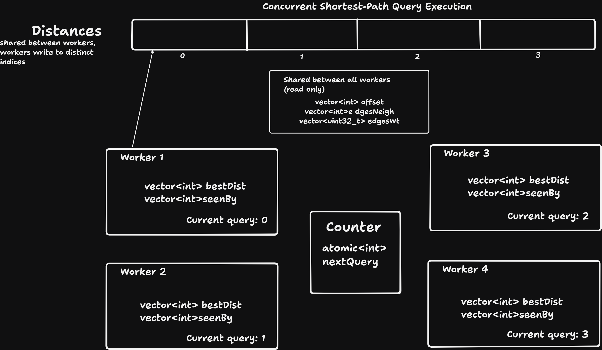

# Track D: Traverse

My implementation for the Speed Demon Track D: Traverse.

## Approach

The solution uses **CSR (Compressed Sparse Row)** to represent the directed weighted graph and runs **Dijkstra's algorithm in parallel** across independent source-target queries.

### 1. Buffered input parsing

I implemented a custom `FastInput` class using `fread()` with a 1 MiB buffer to read input in blocks.

A custom `readUInt()` parser extracts unsigned integers directly from the buffer, avoiding formatted stream extraction when reading the large graph file.

### 2. Graph construction using CSR

While reading the edges, I maintain incoming and outgoing degree information for each vertex and temporarily store the edges.

I then construct the CSR representation using three flat arrays:

- `offset`: Stores the starting position of each vertex's adjacency range.
- `edgesNeigh`: Stores the destination vertex of each edge.
- `edgesWt`: Stores the corresponding edge weight.

Prefix sums over the outgoing degrees determine the adjacency ranges. Once the CSR arrays are populated, the temporary edge list and cursor array are released to reduce memory usage.

Self-loops are skipped during preprocessing.

### 3. Shortest-path computation

For each source-target query, I use Dijkstra's algorithm with a min-priority queue.

The algorithm explores vertices in increasing order of their tentative shortest distance and terminates early when the target is extracted from the priority queue.

Individual edge weights are stored as `uint32_t`, while accumulated path distances use `long long`.

Queries with identical source and target return `0` immediately. Queries whose source has no outgoing edges or whose target has no incoming edges are rejected early as unreachable.

### 4. Lazy distance initialization

Each worker maintains its own `bestDist` and `seenBy` arrays.

Instead of resetting the entire distance array before every query, `seenBy` tracks whether a vertex has been initialized for the current query.

A vertex's distance is initialized to infinity only when it is first encountered during that query. This avoids repeatedly initializing all vertices before every Dijkstra execution.

### 5. Parallel query processing

I use four worker threads to process queries independently.

An atomic counter, `nextQuery`, distributes query indices dynamically among the workers. Each worker maintains its own Dijkstra state, while all workers share the read-only CSR graph.

Results are stored at their original query indices, preserving the input query order regardless of the order in which workers finish.

### 6. Output

After all workers finish, the computed shortest-path distances are written to `distances.txt` in the original query order. Unreachable pairs are represented by `-1`.

## Optimization Journey

I did not arrive at the final implementation in one attempt. I went through multiple iterations, testing different data structures, memory optimizations, compiler options, and concurrency configurations.

Some of the most important changes were:

### 1. Improving data representation

I started with a straightforward Dijkstra implementation and `ifstream` for file input.

I then explored using smaller data types where possible. For example, individual edge weights were changed from `long long` to `uint32_t`, since the input specifies non-negative 32-bit edge weights. Accumulated shortest-path distances continued to use `long long`.

I also explored replacing nested vectors with flat arrays. This led to the CSR representation, which stores adjacency information contiguously and avoids the overhead of separately allocated adjacency vectors.

### 2. Introducing CSR

CSR was one of the most significant improvements to my implementation.

Instead of maintaining a nested adjacency-list structure, I temporarily stored the edges as they were read and then converted them into flat arrays using prefix sums over outgoing degrees.

This gave me contiguous adjacency storage and reduced the overhead associated with nested containers.

After constructing CSR, I explicitly released temporary containers that were no longer needed, reducing memory usage.

### 3. Avoiding repeated distance-array initialization

Initially, I considered resetting the distance array before every Dijkstra execution.

I then explored timestamping using the `seenBy` array. Each query gets a unique identifier, allowing the algorithm to determine whether a vertex's distance has already been initialized for that query.

This eliminated the need to reset the entire distance array between queries.

### 4. Parallelizing independent queries

Since the queries are independent, I explored processing them concurrently using multiple worker threads.

Initially, I assumed that increasing the number of threads would keep improving concurrency and therefore performance.

However, I benchmarked different thread counts: **2, 4, 6, 8, 10, and 12**.

The results showed that four threads provided the best time-memory trade-off for my implementation. Adding more threads did not necessarily improve the overall result.

The architecture below illustrates how I implemented concurrent query execution using worker threads and an atomic query counter.

> This was an important lesson: more concurrency does not automatically translate into better performance.

### 5. Experimenting with compiler flags

I also experimented with compiler optimization flags, particularly `-O2`, `-O3`, and `-march=native`.

`-O3` did not provide a particularly significant benefit over `-O2` in my experiments, while `-march=native` provided some improvements.

### 6. Optimizing input parsing

After implementing the major optimizations, I started timing individual sections of the program to identify the main bottlenecks using chrono.

File reading, particularly reading the graph file, emerged as one of the most time-consuming sections.

I investigated faster file-reading approaches in C++ and explored buffered input using `fread()`.

Instead of relying on formatted extraction for every integer, the custom parser reads blocks of bytes into a buffer and extracts integers directly.

I also benchmarked different buffer sizes, including \(2^8\), \(2^{16}\), and \(2^{20}\) bytes. For my implementation, a buffer size of \(2^{20}\) bytes (1 MiB) performed best.

Before buffered reading [0fab7ea](https://github.com/mayuripaliwal/musical-octo-waddle/commit/0fab7ea38fc72b9c056e1dac2a0c3279dbfcd905): 3.566 seconds

After buffered reading [0dd7ba6](https://github.com/mayuripaliwal/musical-octo-waddle/commit/0dd7ba6db2eeb71dc453f8e346d1bbedd7e11cf5): 2.240 seconds
Overall reduction: 1.326 seconds (~37.2%)

### 7. Lines of Code and tiny optimizations

Since lines of code was also a metric to determine score, I tried to keep the lines of code as low as possible while still keeping it readable.

## Dependencies

None.

## With another 24 hours

Some areas I would investigate:

- **Input parsing:** Explore whether file-reading approaches such as memory mapping could improve graph-loading time compared with the existing buffered parser (I did not implement this approach because of its complexity). 
- **Concurrency:** While 4 threads reduce execution time, the workers execute 1 query at a time. I would explore batching queries and then measuring performance.
